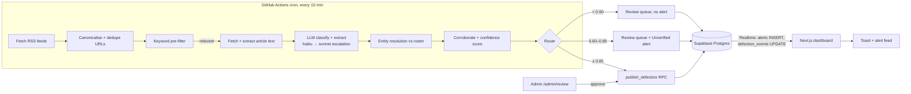
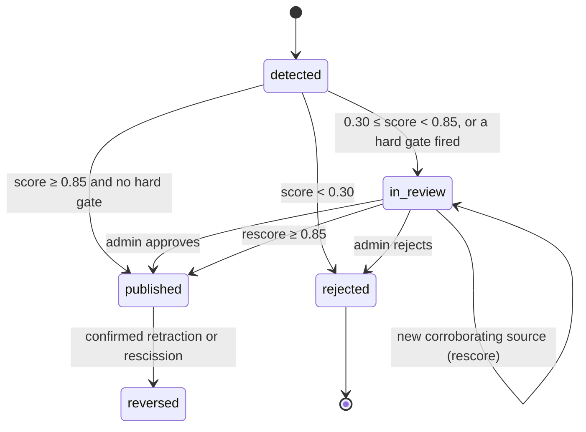
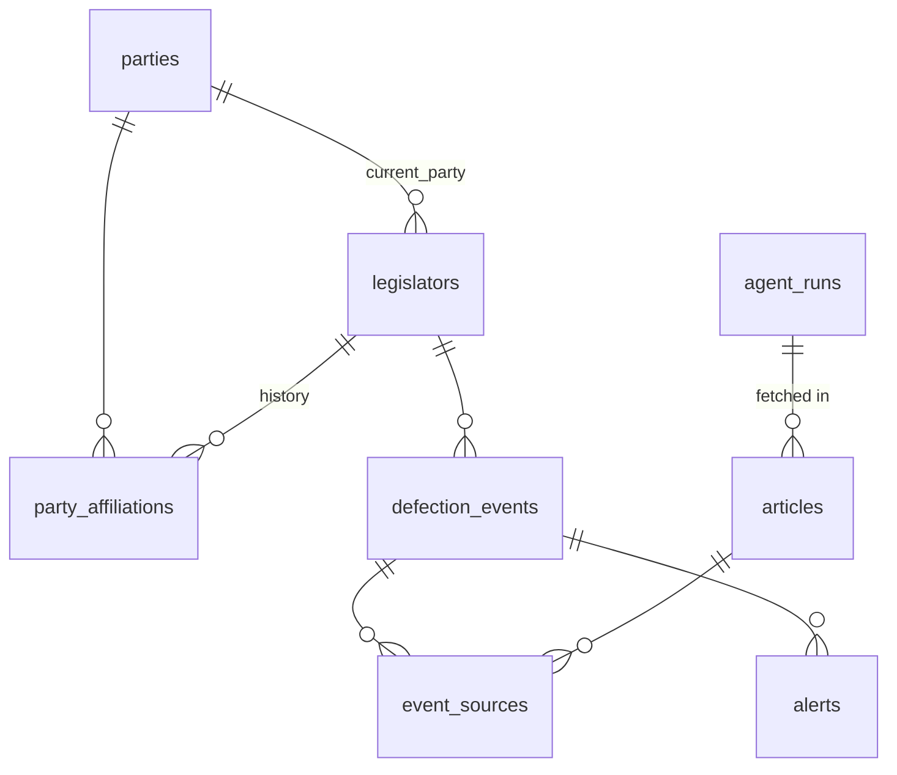

# DecampWatch NG: MVP Specification

**Status:** Draft v1.0 · **Date:** 2026-10-24 · **Owner:** zayyad@advokc.ng
**Companion docs:** [AGENT.md](../AGENT.md) (detection agent design) · [CLAUDE.md](../CLAUDE.md) (implementation rules for Claude Code)

---

## 1. Summary

DecampWatch NG is a web app that tracks party defections ("decamping") by sitting members of Nigeria's 10th National Assembly (Senate: 109, House of Representatives: 360). A scheduled AI agent reads Nigerian political news, detects **completed** defections of **sitting** legislators, scores its confidence, and records each event with its sources. Once an event is published, the dashboard updates in real time and an alert appears in the app, labelled **Confirmed** or **Unverified**.

The guiding principle is **precision over speed**. A false alert costs more credibility than a late one, so rumours are never published as fact.

### 1.1 Goals (MVP)
1. Maintain an authoritative roster of federal legislators with their current party and party history.
2. Detect defections from news within about 30 minutes of publication.
3. Show an interactive dashboard that updates without a page refresh.
4. Show in-app real-time alerts.
5. Provide an admin review queue for low-confidence detections.

### 1.2 Non-goals (MVP)
- State Houses of Assembly (V2).
- Email, Telegram, WhatsApp or SMS alerts (V1).
- Backfilling historical defections since 1999 (V2).
- Predictive "defection risk" scoring (V2).
- A public API (V1).

### 1.3 Success metrics
| Metric | Target |
|---|---|
| Precision of published **Confirmed** alerts | ≥ 95% |
| Recall on completed defections (eval set) | ≥ 85% |
| Entity-resolution accuracy (eval set) | ≥ 95% |
| Detection latency (first publication → event recorded) | ≤ 30 min (median) |
| Monthly running cost | ≤ $20 (LLM + hosting) |

---

## 2. Users

| Persona | Need | Key screens |
|---|---|---|
| Journalist | Fast, sourced alerts they can cite | Alert feed, event page |
| Political analyst / researcher | Party-strength trends and flows | Overview charts, Sankey, table export |
| CSO / election observer | Patterns by state, pre-election surges | Map, timeline, filters |
| Citizen | "Has my senator or rep switched party?" | Legislator search, profile |
| Admin (us) | Approve or reject uncertain detections | `/admin/review` |

**User stories (MVP)**
- As a journalist, I see a toast within seconds of a defection being published, and I can open the sources.
- As an analyst, I can filter by chamber, party, state and date range, and see net party gains and losses.
- As a citizen, I can search a legislator by name or state and see their party history with sources.
- As an admin, I can approve, edit or reject queued detections. Approving one updates the dashboard and fires an alert.

---

## 3. Architecture

### 3.1 Stack decisions (Options → Evaluation → Decision)

| Decision | Options considered | Decision | Why |
|---|---|---|---|
| Web framework | Next.js · Remix · Vite SPA + API | **Next.js (App Router) + TypeScript** | Server components for fast first load, API routes, one deploy target |
| Database + realtime | Supabase · Firebase · Postgres + custom WebSocket server | **Supabase (Postgres + Realtime + Auth)** | Relational data fits; realtime subscriptions and auth are built in; free tier |
| Web hosting | Vercel · VPS with systemd · Docker on VPS | **VPS with systemd and Nginx** | User preference (25 October 2026); one Node process keeps operations simple; Docker adds packaging work; VPS requires patching, TLS renewal and monitoring |
| Agent runtime | Vercel Cron · Supabase pg_cron + Edge Functions · GitHub Actions cron | **GitHub Actions scheduled workflow running `npm run agent`** | Free, runs every 15 min, full Node runtime, visible logs, no serverless timeout |
| LLM | Claude · OpenAI · local model | **Claude API: `claude-haiku-5-5` to classify, escalating to `claude-sonnet-5-5`** | Cheap first pass, stronger model only for ambiguous cases; structured outputs give strict JSON |
| News ingestion | News API · RSS · broad scraping | **Outlet RSS feeds + fetching the article page only for pre-filtered items** | Free, low load on publishers, easy to keep within terms of service |
| Charts | Recharts · Chart.js · D3 | **Recharts** | React-native; has bar, line and Sankey charts |
| Map | Leaflet · react-simple-maps · Mapbox | **react-simple-maps + Nigeria ADM1 GeoJSON/TopoJSON** | No tiles or API key needed; a choropleth of the 36 states + FCT is all we need |
| UI | Tailwind + shadcn/ui · MUI | **Tailwind CSS + shadcn/ui, `sonner` for toasts** | Fast, accessible, light and dark modes |
| Tests | Vitest · Jest | **Vitest** | Fast, works with TypeScript out of the box |
| Database tests (M1) | Local Supabase via Docker · a hosted test project · PGlite (Postgres compiled to WASM, in-process) | **PGlite + a small shim for Supabase's roles and `auth.jwt()`** | No Docker or network needed; runs the real migrations in `npm test` and in CI. Fresh clone per test |
| Reference data (M1) | Seed files · migrations | **States and parties in migrations** | Every environment has them after `db push`; seeds are for rosters only |
| Roster loading (M1) | Row-by-row API inserts · one SQL function | **`seed_roster` RPC: one transaction per file** | A bad row can't leave a half-seeded roster; the function is testable in PGlite |
| Demo visibility (M1) | `DEMO_MODE` env var · database flag | **`app_settings.demo_mode`** | RLS can only read database state, and an env var would let the app and the database disagree |
| Pre-filter placement (M2) | Keep it in M3 and store raw feed items · move it into the ingest stage | **Ingest stage, built in M2** | It decides which article pages are fetched at all (AGENT.md §1, S2→S3). Without it, M2 would either fetch every page or need a column for feed summaries that M3 would immediately make redundant |
| Source tiers (M2) | One tier for all · tier by outlet reputation · tier by measured accuracy | **Tier 1: official NASS channels and national outlets with a politics desk and corrections record; tier 2: business-focused or regional outlets; tier 3: blogs and aggregators** | Accuracy data does not exist yet. The rule is written down in `agent/sources.ts` so changes are reviewable |
| robots.txt failures (M2) | RFC 9309 (401/403 = no rules) · treat any refusal as disallow | **401, 403, 429, 5xx and network errors on robots.txt mean "fetch nothing from this host this run"; 404/410 mean no rules** | A site that refuses our robots.txt request is refusing the bot. Stricter than the RFC on purpose |
| Classifier output (M3) | Forced tool use (as first designed) · one strict tool with `tool_choice: auto` · structured outputs | **Structured outputs (`output_config.format`), no tools** | `claude-sonnet-5-5` rejects forced `tool_choice`, and Haiku 5.5 skips thinking when forced. Structured outputs work on both with thinking on and always parse; Zod still validates the reply |
| Score rounding (M3) | Half up · half to even · show exact values | **Half up to 3 places** (matches `numeric(4,3)`) | One rule for every score; AGENT.md §6.4 example 2 corrected from 0.738 to 0.739 |
| Evidence strength input (M3) | Infer V from quote text · ask the model | **The model sets `evidence_type` per legislator** | V needs to know whether a quote is the legislator's own words; a heuristic on quote marks cannot tell who is speaking |
| Unnamed group members (M3) | Gate the named members · separate review note | **A separate `in_review` event with no legislator, plus a `group_developing` alert** | Named members can still publish on their own evidence; the remainder shows up in the review queue |
| Eval without an API key (M3) | Wait for an API key · let the agent itself use `claude -p` · an eval-only `claude -p` backend | **Eval-only `--llm=claude-cli` backend on the developer's Claude account login; production stays on `ANTHROPIC_API_KEY`** | Lets the prompt be iterated on before a key exists. The account login is not for unattended automation, so the cron agent can't use it. Claude Code's preamble and tool-based structured output make it a different request, so its answers are cached apart, labelled, and don't count as the AGENT.md §7 gate |
| Run log (M4) | Database row only · upload a log artifact · GitHub step summary | **Step summary on the job page + the same text in stdout, alongside the `agent_runs` row** | Readable from the Actions run list with no download or admin page; `/admin/runs` (M7) reads the database row |
| Failure policy (M4) | Fail on any error · never fail · fail on systemic errors only | **Exit 1 only when a stage crashes or no feed is readable; stages are isolated** | A publisher being down is routine and would make the schedule permanently red; a red run should mean the agent or its config needs attention |
| Overlapping runs (M4) | Allow overlap · cancel the running one · queue | **One `concurrency` group, no cancelling** | Crawl delays can push a run past 15 min; cancelling mid-run would leave half-processed articles, and overlap would race on the same rows |
| Agent config in CI (M4) | All in secrets · keys in secrets, tunables in variables | **Keys in Actions secrets; models, thresholds and limits in Actions variables, defaulting in `lib/env.ts`** | Tunables stay visible and editable without a deploy; secrets stay masked |
| Visual design (M5) | shadcn defaults · Advokc house style (advokc.ng) · Promise Tracker style (promisetracker.ng) | **Promise Tracker's style, adapted:** maroon `#77121a` primary, red `#d63321` highlight words, pink washes, navy `#0c1821` ink and footer, Bodoni Moda headings over Inter, pill tabs | The sibling civic-tech product sets reader expectations. Added: a navy dark mode with a rose primary, contrast-checked tokens, and distinct Confirmed/Unverified badges with icons |
| Query typing (M5) | Generated Supabase types · Zod at the query boundary | **Zod schemas in `lib/queries/*`, as the agent does** | No `lib/database.types.ts` has been generated yet; Zod also catches drift at runtime. Switching to generated types later is local to `lib/queries/` |
| Overview freshness (M5) | `use cache` with tags · render per request | **Per request: every query reads cookies, inside `<Suspense>`; the shell stays prerendered** | M6 needs a published event to show within 3 s via `router.refresh()`, which per-request reads give for free |
| Party strength chart (M5) | Recharts stacked bar · plain flex bar | **A labelled flex bar per chamber; Recharts for the Sankey and timeline** | A seat-share strip reads better as one 100% bar, and needs no client JS except the date slider |
| Map data (M5) | Hand-drawn SVG · Natural Earth · geoBoundaries ADM1 | **geoBoundaries NGA ADM1 (GRID3, 2022, CC BY 4.0), simplified to a 59 KB TopoJSON by `npm run build-map`** | Open licence, current state lines, names match `ng_states` with one rename (FCT); attribution in the footer |
| Demo data (updated M7, user request 2026-10-25) | Synthetic events · sourced historical backfill | **`npm run seed -- --demo-events` imports sourced Senate and House records since June 2023 through service-only `seed_historical_events`; `--fictional-events` retains the synthetic development flow** | Real data has source evidence, chronological party chains and historical alert dates; imports are atomic and idempotent. A coverage banner identifies gaps and partial roster totals. See `docs/HISTORICAL_DATA.md`. |
| Realtime scope (M6) | Stream every table · alerts only · alerts + defection_events | **`alerts` and `defection_events` in the `supabase_realtime` publication; nothing else (tested)** | Matches §6.4; Realtime applies the subscriber's RLS and column grants, so anon gets published events only and never article text |
| Live update handling (M6) | Toast on every change · toast on alerts, refresh on both | **A toast per alert INSERT; any alert or event change schedules one `router.refresh()` 300 ms later** | Every publish, review and correction writes an alert, so alerts carry the toast text; event changes without an alert (e.g. a manual SQL edit) still refresh the charts. Measured on the dev project: toast 0.4 s and charts 1.7 s after commit |
| Admin sign-in (M7) | Magic link · email + password · OAuth | **Email + password (Supabase Auth); accounts created in the dashboard, role granted with `npm run admin -- --grant <email>`** | Magic links depend on email delivery (Supabase's default sender is rate-limited); OAuth needs provider setup. `app_metadata` is writable only by the service role, so users can't promote themselves |
| Admin gate (M7) | Proxy only · per page · layered | **`proxy.ts` refreshes the session and redirects signed-out visitors; every admin page and action checks the admin claim (`getClaims`, JWT-verified); the SQL functions check `is_admin()` again** | The Next.js guide treats proxy checks as optimistic only; the database is the gate that can't be skipped |
| Review actions (M7) | Edit then publish in two calls · one SQL function per decision | **`review_approve` (edits + `publish_defection` + feedback in one transaction), `review_edit`, `review_reject`, `review_merge`; reversal stays `reverse_defection`** | A refused publish rolls the edits back, so the queue never holds half-applied corrections; every decision writes `review_feedback` (AGENT.md §8) |
| Merge semantics (M7) | Delete the duplicate · close it | **Sources move to the target; the duplicate becomes `rejected` with reason `duplicate` and a note naming the target** | Keeps the audit trail; nothing is deleted |
| Production LLM without an API key (M4, revisited 27 Oct 2026) | Wait for an API key · pause the schedule · classify via `claude -p` on a Claude subscription | **`AGENT_LLM_BACKEND=claude-cli`: the agent runs `claude -p` (no tools, same schema) with Claude Code's `CLAUDE_CODE_OAUTH_TOKEN` from `claude setup-token`; the API backend stays the default. Scheduled runs without credentials for the chosen backend fall back to ingest-only with a warning** | The owner has a subscription but no API key. Claude Code's token is its supported way to run in CI. Costs: shared subscription usage limits (failed calls leave articles pending for the next run) and Claude Code's preamble, so detection quality is the `--llm=claude-cli` eval's, not the API gate's. Supersedes "the cron agent can't use it" in the M3 row above |
| Crawl pacing (M2) | Fixed 1 req/s per host · honour `Crawl-delay` | **The larger of 1 s and the host's `Crawl-delay`** | Several outlets ask for 10–30 s; feeds change slowly, so the cost is only run time |

Model IDs live in env vars (`CLASSIFIER_MODEL`, `ESCALATION_MODEL`) so they can change without code changes.

### 3.2 Architecture diagram

### 3.3 Event status lifecycle

**Party counts only change when an event becomes `published`.** Unverified alerts never change counts.

---

## 4. Data model

### 4.1 Tables

Enumerations are `text` columns with `check` constraints, not Postgres enums.

**`ng_states`**: name (PK; the 36 states plus `FCT`), zone (geopolitical zone), senate_seats (3, or 1 for the FCT). Loaded by migration.

**`app_settings`**: a single row holding `demo_mode boolean` and nullable `historical_coverage jsonb` (start, reviewed_through, latest_event, complete). RLS reads fictional visibility through `demo_mode()`. It is set with `npm run seed -- --demo-mode on|off`; historical imports hide fictional records and record partial coverage for the public banner.

**`parties`**
| Column | Type | Notes |
|---|---|---|
| id | smallint PK | |
| code | text unique | `APC`, `PDP`, `LP`, `NNPP`, `APGA`, `SDP`, `ADC`, `YPP`, `ADP`, … Loaded by migration from the 2023 ballot; verify against INEC's current register before launch |
| name | text | Full name |
| color | text null | Hex value for charts. Set in Milestone 5 and mirrored in `lib/parties.ts`; each reaches 3:1 contrast on the light and dark page and card backgrounds (tested) |
| aliases | text[] | e.g., `{"All Progressives Congress","the ruling party"}` (the last is only a hint, never an automatic match) |

**`legislators`**
| Column | Type | Notes |
|---|---|---|
| id | uuid PK | |
| full_name | text | Canonical name, no honorifics |
| name_variants | text[] | Spellings, nicknames, transliterations |
| chamber | enum `senate` \| `house` | |
| state | text | One of the 36 states or `FCT` |
| constituency | text | Senatorial district or federal constituency |
| elected_party_id | smallint FK | Party on which they won |
| current_party_id | smallint FK | Changed **only** by `publish_defection` |
| status | enum `sitting` \| `former` \| `deceased` \| `vacated` | |
| photo_url | text null | |
| source_url | text | Where the roster row was verified |
| verified_at | timestamptz | Last manual verification |
| is_fictional | boolean default false | True for demo seed rows; hidden unless `app_settings.demo_mode` |

Constraints: real rows require `source_url` and `verified_at`. There is one sitting member per (chamber, state, constituency). The natural key (chamber, state, constituency, full_name, is_fictional) is unique and is what `seed_roster` matches on.

**`party_affiliations`** (history)
| Column | Type | Notes |
|---|---|---|
| id | bigserial PK | |
| legislator_id | uuid FK | |
| party_id | smallint FK | |
| start_date | date | |
| end_date | date null | Null means current |
| defection_event_id | uuid FK null | The event that opened this affiliation |
| source_url | text null | For seeded history that has no event |

Intervals are half-open, `[start_date, end_date)`: on the day a defection takes effect, the member counts for the new party. At most one open affiliation is allowed per legislator.

**`articles`**
| Column | Type | Notes |
|---|---|---|
| id | bigserial PK | |
| url | text unique | Canonicalised (no `utm_*` parameters, fragment or trailing slash) |
| outlet | text | Key from `agent/sources.ts` |
| title | text | |
| published_at | timestamptz | From the feed; falls back to the page metadata |
| fetched_at | timestamptz | |
| content | text null | Extracted text; **internal only, never served to clients** |
| content_hash | text | SHA-256 of normalised text, used to catch syndicated copies |
| prefilter_hit | boolean | |
| classification | text null | Taxonomy class from AGENT.md |
| processed_at | timestamptz null | |
| run_id | bigint FK agent_runs | |

**`defection_events`**
| Column | Type | Notes |
|---|---|---|
| id | uuid PK | |
| legislator_id | uuid FK null | Null when unresolved (always `in_review`) |
| raw_name | text | Name as written in the source |
| from_party_id / to_party_id | smallint FK null | |
| event_type | text | `CONFIRMED_DEFECTION` \| `FORMAL_PLENARY_ANNOUNCEMENT` \| `GROUP_DEFECTION` |
| is_return | boolean | Returning to a former party |
| event_date | date null | When the defection happened |
| announced_date | date null | Plenary reading date, if any |
| chamber, state | text | Denormalised for filters |
| reason_given | text null | |
| confidence | numeric(4,3) | 0–1 (see AGENT.md §6) |
| score_breakdown | jsonb | Factor values, for auditing |
| status | enum `detected` \| `in_review` \| `published` \| `rejected` \| `reversed` | |
| review_flags | text[] | e.g., `{ambiguous_entity, party_mismatch, speculative_language}` |
| evidence_quote | text | Verbatim span (≤ 300 chars) |
| reasoning_summary | text | From the LLM |
| model, prompt_version | text | Traceability |
| dedupe_key | text unique | Set by the agent from (origin article, legislator or normalised name), so re-processing an article never creates a second event |
| reviewed_by, reviewed_at, review_note | | Admin audit |
| created_at, updated_at | timestamptz | |

**`event_sources`**: (`event_id`, `article_id`, `evidence_quote`). Primary key on the pair.

**`alerts`**
| Column | Type | Notes |
|---|---|---|
| id | bigserial PK | |
| event_id | uuid FK null | Null only for group-level alerts |
| kind | `published` \| `developing` \| `correction` \| `group_developing` | Lets one event have both a publish alert and a correction |
| level | `confirmed` \| `unverified` | |
| title | text | e.g., "Sen. X (Kano Central, Kano) defects from PDP to APC" |
| body | text | One sentence plus the source count |
| is_fictional | boolean | Copied from the legislator, so RLS can hide demo alerts |
| dedupe_key | text unique | e.g., `event:<id>:published`. Makes alert creation idempotent |
| created_at | timestamptz | |

**`review_feedback`**: id, event_id, action (`approve` \| `edit` \| `reject` \| `merge`), reason_code, before jsonb, after jsonb, reviewer, created_at. This table feeds the eval and the name-variant list (AGENT.md §8).

**`agent_runs`**: id, started_at, finished_at, feeds_ok, feeds_failed, articles_new, articles_prefiltered, llm_calls, input_tokens, output_tokens, events_created, events_published, errors jsonb.

### 4.2 Database functions
Callers allowed for all write functions: the service role, an admin user (`publish_defection`/`reverse_defection` only), or a direct database session. The caller is identified by `current_setting('role')`.

- **`publish_defection(event_id uuid)`**: the reviewer is taken from the caller's JWT (`sub`) when an admin calls it, never from an argument. It runs as a single transaction that:
  1. checks the event has a resolved legislator and a `to_party`;
  2. sets `status = 'published'`;
  3. closes the open `party_affiliations` row (`end_date = event_date`);
  4. inserts the new affiliation;
  5. updates `legislators.current_party_id`;
  6. inserts a `confirmed` alert.

  It is **idempotent**: calling it again on a published event does nothing. It refuses, and changes nothing, when:
  - the legislator is unresolved or not sitting;
  - the destination party is unknown or is already the member's party;
  - `from_party` is not the member's current party;
  - the event date precedes the current affiliation.
- **`reverse_defection(event_id uuid, note text)`**: undoes `publish_defection` and inserts a `confirmed` alert titled "Correction: …". It only works on a legislator's most recent defection, and a note is required.
- **`party_strength(chamber text default null, as_of date default today)`**: returns a seat count per party at a date, built from `party_affiliations`. It runs as the caller, so RLS hides fictional seats from the public.
- **`seed_roster(rows jsonb, fictional boolean)`**: service role only (§9).
- **`set_demo_mode(on boolean)`**: service role only.

### 4.3 Row-level security
- **Public (anon) read:**
  - `ng_states`, `parties`, `app_settings`;
  - `legislators` where `is_fictional = false`, or `app_settings.demo_mode` is on; their `party_affiliations` follow the same rule;
  - `defection_events` where `status = 'published'`, excluding the `reviewed_by` and `review_note` columns;
  - `event_sources` for visible events;
  - `articles` (only `id, url, outlet, title, published_at`) that back a visible event;
  - `alerts`, with fictional ones only in demo mode.
- **Admin role** (Supabase Auth, `app_metadata.role = 'admin'`): read every row of every table, plus `agent_runs` and `review_feedback`. Admins can call `publish_defection`, `reverse_defection` and, in Milestone 7, the reject action. Admins have no direct table writes.
- **Agent and scripts:** service-role key, server-side only (GitHub Actions secret). Never exposed to the browser.
- **`articles.content` is not granted to anon or authenticated users at all.** The admin UI reads it through a server action using the service role. Because of column-level grants, anon queries on `articles` and `defection_events` must list their columns; `select *` is refused.
- Defence in depth: anon and authenticated have no INSERT, UPDATE, DELETE or TRUNCATE privileges on any table. Default privileges are revoked, so new tables start with no API access.

---

## 5. Agent (summary)

The full design is in [AGENT.md](../AGENT.md). Pipeline:

`fetch feeds → canonicalise/dedupe → keyword pre-filter → extract text → classify + extract (LLM, structured output) → entity resolution → event dedupe/corroboration → confidence score → route → emit`

**Hard rules:**
- Speculation, denials, non-legislators, former legislators and passing historical mentions **never** create a publishable event.
- Group defections are split into one event per named legislator. Unnamed members ("and 4 others") go to review, not to automatic updates.
- Every event stores its source URLs, outlet, timestamps, a verbatim quote, the model and the prompt version.

---

## 6. Dashboard

### 6.1 Routes
| Route | Content |
|---|---|
| `/` | Overview: KPI cards, party strength per chamber, party-flow Sankey, state map, defection timeline, live alert feed |
| `/legislators` | Filterable, sortable table with search |
| `/legislators/[id]` | Profile: photo, chamber, state and constituency, party-history timeline with source links |
| `/events/[id]` | Event detail: from → to, dates, evidence quotes, all sources, confidence label, correction history |
| `/admin/review` | Auth-gated review queue |
| `/about` | Methodology, source list, confidence labels, corrections policy, disclaimer |

### 6.2 Overview components
- **KPI cards:** total defections (in the filter range), defections in the last 7 days, the biggest net gainer, the biggest net loser.
- **Party strength:** a stacked bar per chamber at today's date, with a date slider showing strength "as of" any date (from `party_strength`).
- **Party flows:** a Sankey chart of from-party → to-party counts in the range.
- **Map:** a choropleth of defections per state; hovering shows the count and top flow; clicking filters the page by state.
- **Timeline:** defections per week as a line or bars; clicking a point lists those events.
- **Alert feed:** the 20 most recent alerts with a Confirmed or Unverified badge, kept live through Realtime.

### 6.3 Filters
Chamber, party (from or to), state, date range, and status (admins only). Filters are stored in the URL query string so views can be shared.

### 6.4 Realtime behaviour
A client component subscribes to `alerts` INSERT and `defection_events` UPDATE through Supabase Realtime. When an event arrives it:
1. shows a `sonner` toast (Confirmed in the primary colour, Unverified in a muted/amber colour, with a link);
2. prepends the alert to the feed;
3. calls `router.refresh()` to update server-rendered charts.

No manual page refresh is needed.

### 6.5 Labelling rules (shown on `/about` and in the UI)
- **Confirmed:** published by the agent at confidence ≥ 0.85, or approved by an admin. Counts are updated.
- **Unverified / Developing:** confidence is between 0.60 and 0.85 and the event is awaiting review. Counts are **not** updated.
- Every alert and event links to its sources.

---

## 7. Alerts (MVP: in-app only)

| Trigger | Level | Title template |
|---|---|---|
| Event published (agent or admin) | confirmed | `{honorific} {name} ({state} {constituency}) defects from {FROM} to {TO}` |
| Event routed to review at 0.60–0.85 | unverified | `Developing: reports say {name} has defected to {TO}` |
| Event reversed | confirmed | `Correction: {name} defection record withdrawn` |
| Group defection with unresolved names | unverified | `Developing: {n} {chamber} members reported to have joined {TO}` |

Each alert has a body with one sentence and the source count. Alerts are deduplicated per event and level.

---

## 8. Non-functional requirements

- **Ethics and legal:**
  - Never present rumours as fact.
  - Show only the headline, a short evidence quote (≤ 300 characters) and a link for each source. Do not republish article bodies.
  - Respect `robots.txt` and outlet terms of service.
  - Send an identifying `User-Agent` header and a contact email.
  - Rate-limit to ≤ 1 request per second per host.
  - Provide a corrections and contact route on `/about`.
  - Store public-role data only. The Nigeria Data Protection Act (NDPA) 2023 applies; collect no private data on legislators.
- **Security:**
  - The service-role key is used only in GitHub Actions and server code.
  - Admin routes are protected by middleware and RLS.
  - Article text is treated as untrusted input to the LLM (see AGENT.md §4.4 on prompt injection).
- **Cost:** log token usage per run in `agent_runs`. The pre-filter should send ≤ 5% of articles to the LLM. Alert on cost overruns in V1.
- **Reliability:**
  - Each feed failure is logged without stopping the run.
  - Runs are idempotent: re-running over the same articles must not create duplicate events or alerts.
- **Observability:** an `agent_runs` table plus an admin-only `/admin/runs` page (Milestone 7).
- **Accessibility:** colour is never the only signal (badges have text), maps and charts have table alternatives, and the app is keyboard-navigable.
- **Performance:** overview first load ≤ 2.5 s LCP on a 4G connection. Chart queries go through SQL functions, not client-side aggregation.

---

## 9. Seeding the roster

Loading uses `npm run seed`. The script validates the CSV, then calls `seed_roster` once, so the whole file is loaded in one transaction. Re-running updates metadata and never changes parties; a differing party is reported as a warning. Columns are documented in `supabase/seed/README.md`.

1. **Demo:** load `supabase/seed/legislators.fictional.csv` with `--fictional` (clearly fictional names, `is_fictional = true`). Used for development and UI demos. Turn on `--demo-mode on` to show it.
2. **Real roster:**
   1. Fill `supabase/seed/legislators.template.csv` from official sources: the National Assembly website member listings, INEC certified 2023 results, and by-election results since 2023.
   2. Record `source_url` and `verified_at` for every row.
   3. Apply known defections since inauguration (June 2023) as `party_affiliations` history, each sourced.
   4. Have a second person verify the rows before production.
3. `npm run seed -- --file <csv>` validates the rows: chamber counts, valid state names, known party codes, and no duplicate names within a state and chamber.

**Never invent current party numbers in code, seed files or UI copy.**

---

## 10. Milestones and acceptance criteria

Each milestone ends in a runnable, demonstrable state. Claude Code pauses after each one for confirmation (see CLAUDE.md).

| # | Milestone | Acceptance criteria |
|---|---|---|
| 0 | Project setup | `npm run dev` serves a placeholder page; lint, typecheck and `npm test` pass; `.env.example` is complete; folder structure matches CLAUDE.md |
| 1 | Schema + roster seed | Migrations apply cleanly; `publish_defection`, `reverse_defection` and `party_strength` exist and have SQL tests; fictional roster is seeded; RLS verified (anon cannot read `articles.content`) |
| 2 | News ingestion | `npm run agent -- --stage=ingest` fetches all configured feeds, canonicalises and dedupes URLs, applies the keyword pre-filter, extracts the page text of articles that pass, stores articles, records an `agent_runs` row; re-running inserts 0 duplicates; robots.txt is checked |
| 3 | Detection agent | Classifier (structured output), resolver, scorer and router are implemented per AGENT.md; `npm run eval` passes the thresholds in §1.3 on the fixture set; `--dry-run` prints decisions without writing to the database |
| 4 | Scheduling + orchestration | `.github/workflows/agent.yml` runs every 15 min; secrets are documented; a run log summary is written; one feed failing does not fail the run; token counts are logged |
| 5 | Dashboard UI | All `/` components plus `/legislators`, profile and event pages work with filters stored in the URL; light and dark modes; table alternatives for charts and the map |
| 6 | Realtime + alerts | Inserting a published event (via SQL or the admin panel) shows a toast and updates the charts in under 3 seconds with no refresh |
| 7 | Admin review | Auth-gated queue with approve, edit and reject; approving calls `publish_defection`; reversal flow; `/admin/runs` page |
| 8 | Deploy + launch | Deployed to a VPS with Supabase production; the launch checklist (§11) is complete |

---

## 11. Launch checklist

- [ ] Real roster seeded, every row verified by two people and sourced
- [ ] Supabase Auth: public sign-ups disabled, admin accounts created by hand, `npm run admin -- --list` shows only intended admins
- [ ] Demo mode off in production (`npm run seed -- --demo-mode off`), so fictional rows and demo events are hidden
- [ ] Eval passes: Confirmed precision ≥ 95%, recall ≥ 85%, entity accuracy ≥ 95%
- [ ] A dry-run of the agent for 72 h, with no false Confirmed alerts
- [ ] `/about` methodology, disclaimer and corrections contact are live
- [ ] robots.txt and terms of service reviewed for every configured outlet (as of M2, the terms of Punch, Vanguard, Channels TV and BusinessDay still need a manual read; see `review` in `agent/sources.ts`)
- [ ] RLS audit: anon cannot read drafts, review items or article bodies
- [ ] Service-role key exists only in GitHub and VPS server environments
- [ ] Database backups enabled; restore tested once
- [ ] Cost check: projected monthly spend is within budget
- [ ] `app_settings.demo_mode` is off (`npm run seed -- --demo-mode off`) and fictional rows are hidden

---

## 12. Roadmap after the MVP

1. **V1:** Telegram and email alerts with per-user subscriptions (party, state, legislator); a public read-only API; CSV export.
2. **V1:** Second-opinion verification. Re-check each Confirmed event when a new article arrives, and flag contradictions.
3. **V2:** State Houses of Assembly (36 × roster), including Section 109(1)(g) context.
4. **V2:** Historical backfill (1999 onward), with analytics on defection waves around election cycles.
5. **V2:** "Defection risk" signals (party crises, primary disputes, governor defections). Clearly labelled as analysis, never as alerts.

---

## 13. Assumptions (change these if they are wrong)

| Assumption | Default used |
|---|---|
| Scope | Senate + House of Representatives |
| Developer environment | Windows 11, VS Code, PowerShell, Node 22 LTS+ |
| LLM | Anthropic Claude API key available |
| Budget | ≤ $20/month |
| Pace | Pause after every milestone |
| Hosting | VPS (web) + Supabase (DB) + GitHub Actions (agent) |
